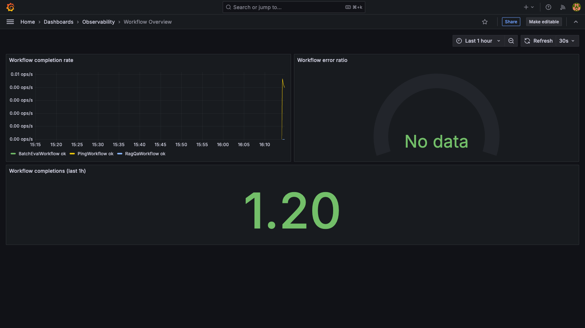

<!-- generated-by: gsd-doc-writer -->
# Temporal-Orchestrated Observability Platform

**Durable AI workflows on Temporal, instrumented with Kotlin + OpenTelemetry, observed through the LGTM stack.**

[](https://github.com/tazzledazzle/temporal-orchestrated-observability-platform/actions/workflows/ci.yml)


## Screenshots

> **To regenerate this screenshot:** start the Docker Compose stack, run `./scripts/lgtm-sample-load.sh`, then open Grafana at [http://localhost:3000/d/workflow-overview](http://localhost:3000/d/workflow-overview) (`admin`/`admin`).



The **Workflow Overview** dashboard (`deploy/grafana/dashboards/workflow-overview.json`) shows:

- **Workflow throughput** — workflows started and completed per minute (Prometheus counter)
- **Activity RED metrics** — requests, error rate, and p50/p95/p99 duration for each activity type
- **End-to-end trace timeline** — correlated spans from Starter → Temporal → Worker → LLM stub (via Tempo)
- **Structured log stream** — `service_name="ai-temporal-worker"` log lines with `workflow_id` and `activity_type` fields (via Loki)

Additional dashboards provisioned in `deploy/grafana/dashboards/`:
| Dashboard | Path | Purpose |
|-----------|------|---------|
| Workflow Overview | `/d/workflow-overview` | Throughput, activity RED, traces, logs |
| Activity Latency | `/d/activity-latency` | Per-activity p50/p95/p99 heatmaps |
| LLM Proxy | `/d/llm-proxy` | WireMock LLM stub request rates and latencies |

## Overview

This repository is a reference implementation for running **AI-style workflows** (RAG Q&A, agent tool use, batch evaluation) as **Temporal workflows** on a **Kotlin worker** with **OpenTelemetry** instrumentation. Traces, metrics, and structured logs flow through an **OTel Collector** into **Jaeger/Tempo**, **Prometheus**, and **Loki**, unified in **Grafana** for operators and on-call engineers.

It is portfolio-scoped: one Temporal namespace, local Docker Compose, sample workflows, and operator dashboards—not a multi-tenant production SaaS.

## Features

- **Temporal orchestration** — durable workflows with retriable activities and deterministic replay
- **Sample AI workflows** — `PingWorkflow`, `RagQaWorkflow`, `AgentToolsWorkflow`, and `BatchEvalWorkflow`
- **Kotlin worker** — polls task queue `ai-workflows`; activities execute LLM calls, retrieval, and tool-use patterns
- **OpenTelemetry instrumentation** — workflow/activity spans, RED-style metrics on `:9464/metrics`, trace correlation attributes
- **LGTM stack in Compose** — Loki, Grafana, Tempo, Prometheus, Promtail, and OTel Collector
- **LLM stub** — WireMock service for local development without live API keys
- **Grafana dashboards** — workflow overview, activity latency, and LLM proxy panels (provisioned under `deploy/grafana/`)
- **Operations runbooks** — alert response guidance in [docs/OPERATIONS.md](docs/OPERATIONS.md)
- **Verification scripts** — smoke, trace, metrics, and sample-load checks under `scripts/`

## Architecture

```
Starter CLI ──► Temporal Server ──► Kotlin Worker (OTel SDK)
                      │                    │
                      │                    ├──► OTel Collector ──► Jaeger / Tempo
                      │                    │                         │
                      │                    └──► Prometheus ◄──────────┤
                      │                                              │
Worker JSON logs ──► Promtail ──► Loki ──────────────────────────► Grafana
```

See [docs/ARCHITECTURE.md](docs/ARCHITECTURE.md) for data flows, component boundaries, and ADRs.

## Prerequisites

| Requirement | Notes |
|-------------|-------|
| **JDK 21** | Temurin recommended (`jvmToolchain(21)` in Gradle) |
| **Docker Desktop** | ≥ **8 GB RAM** allocated |
| **curl** | Required by smoke and verification scripts |

## Quick Start

```bash
git clone https://github.com/tazzledazzle/temporal-orchestrated-observability-platform.git
cd temporal-orchestrated-observability-platform

cp .env.example .env   # optional — defaults work

docker compose -f deploy/docker-compose.yml up -d
./scripts/smoke.sh
./gradlew build test
```

Open the UIs:

| Service | URL |
|---------|-----|
| Grafana | http://localhost:3000 (`admin` / `admin`) |
| Temporal UI | http://localhost:8080 |

Load sample observability data (logs, traces, dashboards):

```bash
./scripts/lgtm-sample-load.sh
```

## Usage / Workflows

Start order: **Compose → worker → starter**.

**Terminal 1 — platform** (if not already running):

```bash
docker compose -f deploy/docker-compose.yml up -d
./scripts/smoke.sh
```

**Terminal 2 — worker:**

```bash
export OTEL_EXPORTER_OTLP_ENDPOINT=http://localhost:4317
./gradlew :worker:run
# Expect: Worker started — polling ai-workflows at localhost:7233
```

**Terminal 3 — run a workflow:**

```bash
./gradlew :starter:run --args="ping"
# Expect: workflow_id=ping-<uuid>  result=pong
```

### AI workflows

Requires the **LLM stub** (WireMock) in addition to Temporal:

```bash
docker compose -f deploy/docker-compose.yml up -d temporal temporal-ui llm-stub
export LLM_STUB_URL=http://localhost:8090

./gradlew :worker:run                                    # terminal 1
./gradlew :starter:run --args="rag What is Temporal?"
./gradlew :starter:run --args="agent Summarize observability"
./gradlew :starter:run --args="batch demo-eval 5"
```

| Command | Workflow | Description |
|---------|----------|-------------|
| `ping` | `PingWorkflow` | Minimal health check (`pong`) |
| `rag [question]` | `RagQaWorkflow` | Retrieval-augmented Q&A |
| `agent [goal]` | `AgentToolsWorkflow` | Multi-step agent with tool calls |
| `batch [dataset] [n]` | `BatchEvalWorkflow` | Batch evaluation (default `n=5`) |

Bundled E2E scripts:

```bash
./scripts/ping-e2e.sh           # PingWorkflow end-to-end
./scripts/ai-workflows-e2e.sh   # rag, agent, batch
```

See [docs/LOCAL-DEV.md](docs/LOCAL-DEV.md) for graceful shutdown, environment variables, and troubleshooting.

## Observability

| Service | URL | Purpose |
|---------|-----|---------|
| Grafana | http://localhost:3000 | Dashboards and Explore (logs ↔ traces) |
| Temporal UI | http://localhost:8080 | Workflow history and retries |
| Jaeger UI | http://localhost:16686 | Dev trace search (`ai-temporal-worker`) |
| Prometheus | http://localhost:9090 | Metrics and scrape targets |
| Loki | http://localhost:3100 | Log aggregation |
| Worker metrics | http://localhost:9464/metrics | Prometheus scrape endpoint |
| OTLP (gRPC) | `localhost:4317` | Trace export from worker |

After `./scripts/lgtm-sample-load.sh`, open Grafana → **Observability** folder dashboards. Example Loki query:

```logql
{service_name="ai-temporal-worker"} |= "workflow_id"
```

See [docs/GRAFANA.md](docs/GRAFANA.md) for dashboard details and Explore queries.

## Development

```bash
./gradlew build test
./gradlew test --tests "*Workflow*"
```

### Verification scripts

| Script | Checks |
|--------|--------|
| `./scripts/smoke.sh` | Compose stack health (Temporal, Grafana, Prometheus, Loki, Jaeger, OTel Collector) |
| `./scripts/otel-smoke.sh` | Worker Prometheus metrics at `:9464/metrics` |
| `./scripts/trace-smoke.sh` | End-to-end traces in Jaeger + Prometheus scrape target |
| `./scripts/lgtm-sample-load.sh` | Sample logs, traces, and Grafana dashboard data |
| `./scripts/ping-e2e.sh` | PingWorkflow with auto-started worker |
| `./scripts/ai-workflows-e2e.sh` | RAG, agent, and batch workflows |

CI (`.github/workflows/ci.yml`) runs `./gradlew build test`, validates Docker Compose, OTel Collector config, and Prometheus alert rules on push/PR to `main` and `develop`.

## Documentation

| Doc | Purpose |
|-----|---------|
| [docs/LOCAL-DEV.md](docs/LOCAL-DEV.md) | URLs, worker/starter setup, workflows |
| [docs/GRAFANA.md](docs/GRAFANA.md) | Dashboards and Explore queries |
| [docs/OPERATIONS.md](docs/OPERATIONS.md) | On-call runbooks and alert rules |
| [docs/ARCHITECTURE.md](docs/ARCHITECTURE.md) | System design and requirements |
| [docs/adr/](docs/adr/) | Architecture decision records |
| [docs/TDD-ALIGNMENT.md](docs/TDD-ALIGNMENT.md) | Test-driven design alignment notes |

## Project structure

```
deploy/          Docker Compose, OTel Collector, LGTM configs, LLM stub, Grafana dashboards
workflows/       Temporal workflow interfaces, models, and activity contracts
worker/          Kotlin worker, activity implementations, OpenTelemetry telemetry
starter/         CLI to trigger workflows (ping, rag, agent, batch)
scripts/         Smoke, trace, metrics, and E2E verification scripts
docs/            Architecture, local dev, operations, and ADRs
```

Gradle modules: `:workflows`, `:worker`, `:starter`.

## Contributing

Contributions are welcome. Open an issue or pull request on GitHub. For local setup, follow **Quick Start** and [docs/LOCAL-DEV.md](docs/LOCAL-DEV.md). Run `./gradlew build test` and relevant scripts from the verification table before submitting changes.

---

*Implementation planning and phase verification notes live in [`.planning/`](.planning/) for maintainers.*
